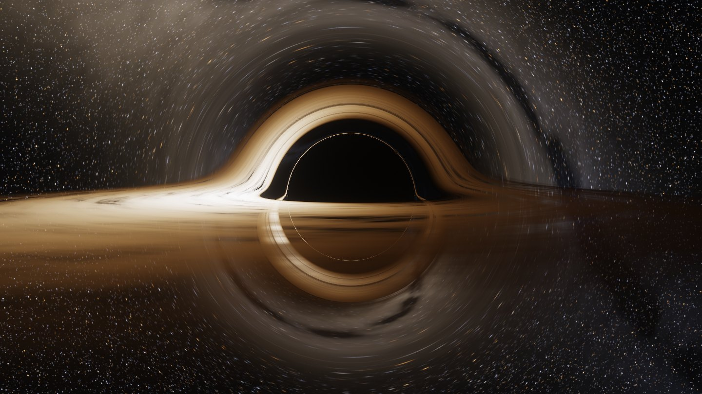
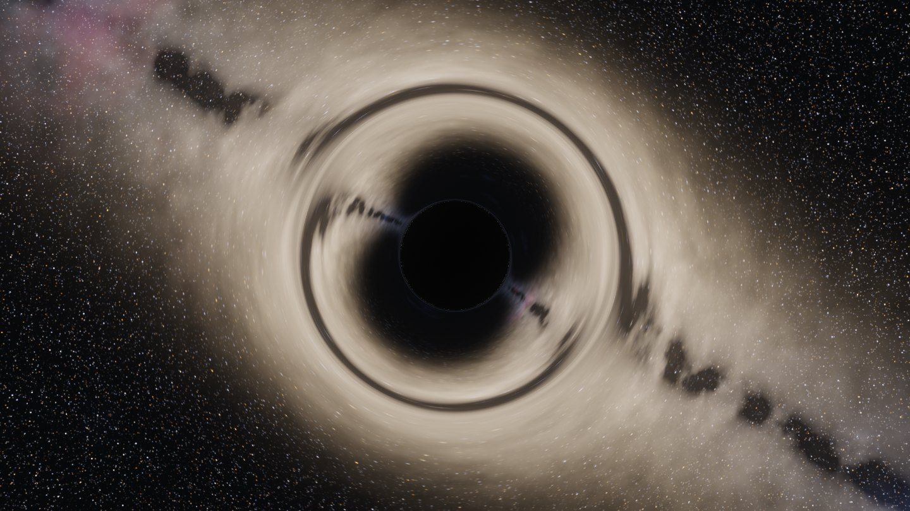
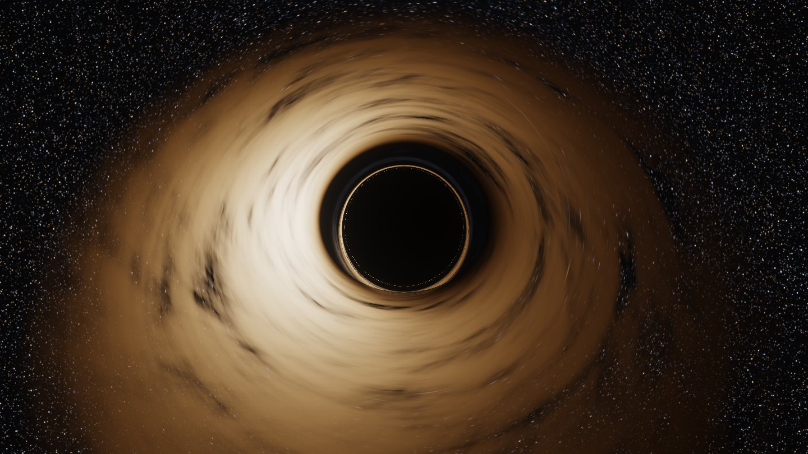
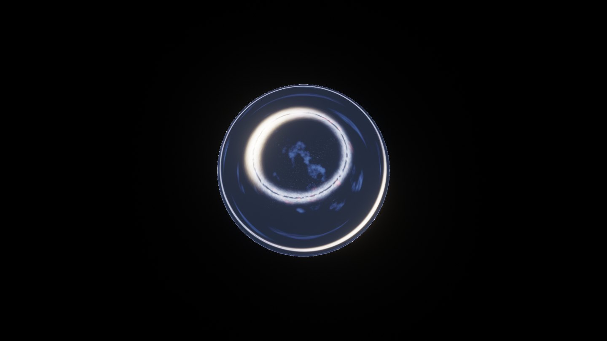
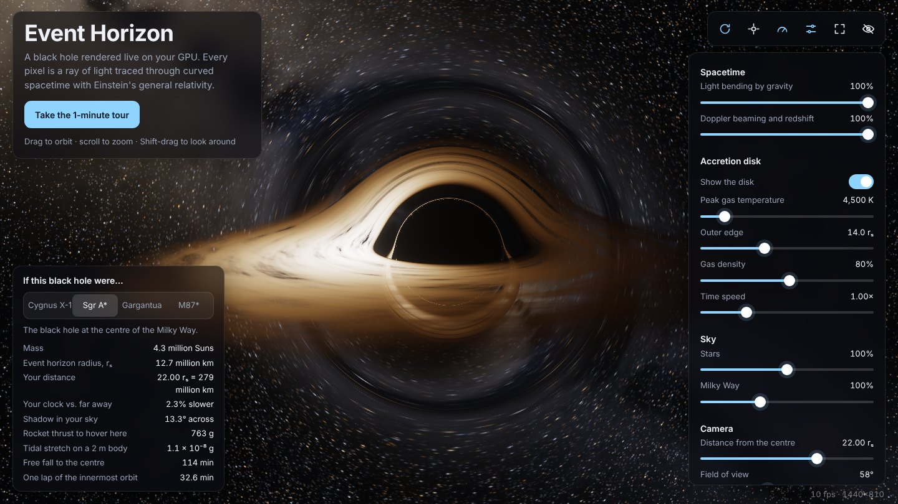

# Event Horizon

**A real-time black hole you can fly around, rendered with general relativity in your browser.**

Every pixel traces a ray of light backwards through the curved spacetime of a Schwarzschild black hole, live on the GPU with WebGL2. The gravitational lensing, the photon ring, Doppler beaming and gravitational redshift all come out of the physics, not from artistic tricks.

### [Live demo →](https://muhammad-zaheeb.github.io/event-horizon/)



| Einstein ring | Face-on disk | Hovering 4% above the horizon |
|---|---|---|
|  |  |  |

## How the shadow arises

The size of the black hole's shadow is not drawn in; it follows directly from the physics the shader integrates. Light with an impact parameter below the critical value √27·M is captured by the black hole, and the photon sphere sits at r = 3M, which is 1.5 times the horizon radius r = 2M.

## Features

- **Exact light paths:** Schwarzschild null geodesics integrated per pixel (symplectic leapfrog with adaptive steps)
- **Physical camera:** a static observer, with correct aberration and gravitational blueshift all the way down to just above the horizon
- **Accretion disk:** Shakura–Sunyaev temperature profile, Keplerian differential rotation, animated turbulence
- **Physically based colour:** Planck spectrum × CIE 1931 colour-matching functions → sRGB, shifted by the full relativistic factor *g*
- **Lensed sky:** procedural Milky Way and star field, anti-aliased through the lens map
- **HDR pipeline:** bloom, ACES tone mapping, dithering
- **Guided tour:** one minute, switching light bending and Doppler beaming off and on so you can see what each does
- **Real-unit readouts** for Sgr A\*, M87\*, Cygnus X-1 and Gargantua: time dilation, rocket thrust to hover, tidal stretch, free-fall time
- **Smooth on laptops:** dynamic resolution holds ~60 fps and detects frame-rate caps such as Low Power Mode
- **Zero dependencies:** one self-contained `index.html`, no build step



## The physics in brief

In units where rₛ = 1, light follows

```
d²x/dλ² = −(3/2) h² x / r⁵        h = |x × dx/dλ|  (conserved)
```

which reproduces the exact Schwarzschild photon orbit equation u″ + u = 3Mu². Light from the disk is shifted by

```
g = √(1 − 3M/r) / [ (1 − Ωℓ) · √(1 − 2M/r_cam) ]
```

combining Doppler beaming from the orbiting gas with gravitational redshift, as seen by a static camera.

## Controls

| Input | Action |
|---|---|
| Drag | Orbit |
| Scroll / pinch | Zoom |
| Shift-drag or right-drag | Look around |
| Space | Auto-orbit |
| T | Guided tour |
| G | Light bending on/off |
| D | Disk on/off |
| H | Hide interface |
| F | Fullscreen |
| R | Reset view |

## Run locally

Open `index.html` in a recent Chrome, Safari, Edge or Firefox (WebGL2 required), or serve the folder:

```bash
python3 -m http.server 8000   # then open http://localhost:8000
```

## Credits

Idea and direction: **Muhammad Zaheeb**
Made with **Claude** (Anthropic's AI), which wrote the code.

## License

MIT
